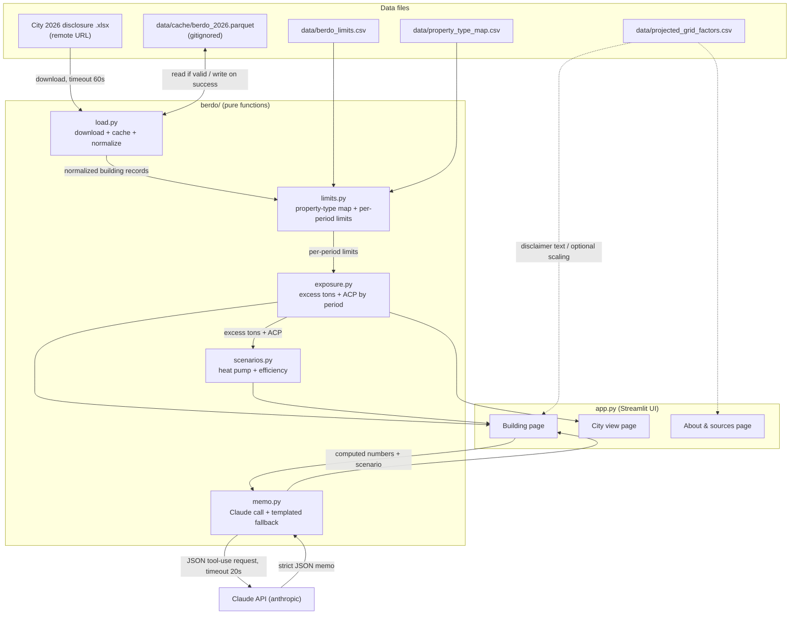

# Design Document

## Overview

BERDO Gap is a Streamlit web application that estimates a Boston building's yearly Alternative Compliance Payment (ACP) exposure under BERDO, models how heat-pump and efficiency retrofits change that exposure, and drafts a board memo through the Claude API.

The design enforces a strict separation between presentation and computation:

- **`app.py`** is the only Streamlit file. It renders three pages (Building, City view, About & sources), reads user inputs, calls pure functions in `berdo/`, and formats results for display (rounding tons to 1 decimal and dollars to whole dollars). The UI performs no calculation of its own and displays only numbers that came from a `berdo/` function or directly from the City's data file.
- **`berdo/`** is a pure-Python package. Every function has type hints, takes explicit arguments, returns explicit values, and avoids hidden global state. All money and tonnage are computed in floats with no intermediate rounding; rounding happens only at the display boundary in `app.py`.

This separation makes the calculation layer fully testable in isolation. The correctness of the calculators is pinned by Hypothesis property-based tests (P1–P7, P9), hand-checked golden buildings, and whole-dataset regression totals.

Scope note: the blended standard, the green-power scenario, and correctness property P8 are explicitly out of scope this session and are not designed here.

## Architecture

### Component diagram



### Data flow

1. **Load**: `load.py` loads the disclosure. If a valid cached parquet exists, it reads the cache; otherwise it downloads the Excel workbook (timeout 60 s), normalizes it, filters to buildings with emissions and floor area, and writes the cache.
2. **Limits**: `limits.py` maps each building's `Largest Property Type` to a BERDO use, then resolves a per-period limit vector, honoring the City's applied 2025–2029 standard when present.
3. **Exposure**: `exposure.py` turns emissions, limit, and floor area into excess tons and ACP for each of the six periods, honoring the first compliance year.
4. **Scenarios**: `scenarios.py` transforms a building's energy and emissions under efficiency and heat-pump retrofits; the transformed emissions feed back into exposure.
5. **UI**: `app.py` renders the Building, City view, and About pages, applying display rounding and disclaimers.
6. **Memo**: `memo.py` builds a payload from computed numbers, calls Claude via tool use, and falls back to a templated memo on any failure.

## Components and Interfaces

### `berdo/load.py` — load, cache, normalize

Normalized column-name constants (module-level) map the City's exact Excel headers to stable identifiers used downstream:

```python
COL_BERDO_ID = "berdo_id"
COL_ADDRESS = "address"
COL_PARCEL_ADDRESS = "parcel_address"
COL_ZIP = "zip"
COL_PARCEL_ZIP = "parcel_zip"
COL_FLOOR_AREA = "floor_area_sqft"
COL_LARGEST_PROPERTY_TYPE = "largest_property_type"
COL_TOTAL_SITE_ENERGY = "total_site_energy_kbtu"
COL_NATURAL_GAS_KBTU = "natural_gas_kbtu"
COL_ELECTRICITY_KWH = "electricity_kwh"
COL_TOTAL_GHG = "total_ghg_kgco2e"
COL_NATURAL_GAS_GHG = "natural_gas_kgco2e"
COL_ELECTRICITY_GHG = "electricity_kgco2e"
COL_APPLICABLE_STANDARD = "applicable_standard"
COL_COMPLIANCE_STATUS = "compliance_status"
COL_FIRST_COMPLIANCE_YEAR = "first_compliance_year"
COL_EUI = "eui"

# Source -> normalized header mapping (City's exact names on the left)
SOURCE_COLUMNS: dict[str, str] = {
    "BERDO ID": COL_BERDO_ID,
    "Building Address": COL_ADDRESS,
    "Parcel Address": COL_PARCEL_ADDRESS,
    "Building Address Zip Code": COL_ZIP,
    "Parcel Address Zip Code": COL_PARCEL_ZIP,
    "Gross Floor Area (sq ft)": COL_FLOOR_AREA,
    "Largest Property Type": COL_LARGEST_PROPERTY_TYPE,
    "Total Site Energy Usage (kBtu)": COL_TOTAL_SITE_ENERGY,
    "Natural Gas Usage (kBtu)": COL_NATURAL_GAS_KBTU,
    "Electricity Usage (kWh)": COL_ELECTRICITY_KWH,
    "Total GHG Emissions (kgCO2e)": COL_TOTAL_GHG,
    "Natural Gas Emissions (kgCO2e)": COL_NATURAL_GAS_GHG,
    "Electricity Emissions (kgCO2e)": COL_ELECTRICITY_GHG,
    "Applicable Emissions Compliance Standard (kgCO2e/sq ft)": COL_APPLICABLE_STANDARD,
    "Emissions Compliance Status": COL_COMPLIANCE_STATUS,
    "First Emissions Compliance Year": COL_FIRST_COMPLIANCE_YEAR,
}

# The "Site EUI (Energy Use Intensity kBtu/ft²)" column is deliberately NOT
# in SOURCE_COLUMNS: in this file it holds emissions intensity, not EUI.
```

Functions:

```python
def load_disclosure(
    cache_path: str = "data/cache/berdo_2026.parquet",
    url: str | None = None,
    timeout: float = 60.0,
) -> pd.DataFrame:
    """Return the normalized, filtered disclosure as a DataFrame.

    If a valid cached parquet exists at cache_path (readable and containing
    every required normalized column), load from it. Otherwise download the
    workbook from url (default: the URL recorded in DATA_NOTES.md) with the
    given timeout, normalize, filter, write the cache, and return the result.
    Raises LoadError on download failure/timeout or missing source columns.
    Satisfies: R1.1, R1.2, R1.3, R1.4, R1.5, R1.7.
    """

def read_disclosure_excel(url: str, timeout: float) -> pd.DataFrame:
    """Download and read the 'Buildings & Campuses' sheet (header row 1).
    Raises LoadError if the download fails or times out (cache preserved).
    Satisfies: R1.1, R1.4, R1.5.
    """

def normalize_columns(raw: pd.DataFrame) -> pd.DataFrame:
    """Rename source headers to normalized identifiers via SOURCE_COLUMNS,
    coerce fuel/emission cells to numeric with blanks/non-numeric -> 0, and
    treat a blank Applicable_Standard as missing (NaN). When a building's
    Building Address (COL_ADDRESS) is blank, fall back to its Parcel Address
    (COL_PARCEL_ADDRESS) for the building's display address.
    Raises LoadError naming any absent required source columns; the cache is
    not written in that case.
    Satisfies: R1.6, R1.9, R1.12, R1.13.
    """

def filter_reported(df: pd.DataFrame) -> pd.DataFrame:
    """Retain only rows with total_ghg_kgco2e > 0 AND floor_area_sqft > 0.
    Satisfies: R1.8, R10.2.
    """

def compute_eui(total_site_energy_kbtu: float, floor_area_sqft: float) -> float:
    """Return Total Site Energy Usage (kBtu) / Gross Floor Area (sq ft).
    Never derived from the City's 'Site EUI' column.
    Satisfies: R1.10, R1.11.
    """

def is_cache_valid(cache_path: str) -> bool:
    """True iff the parquet at cache_path is readable and has every required
    normalized column. Satisfies: R1.2, R1.3.
    """

def write_cache(df: pd.DataFrame, cache_path: str) -> None:
    """Write the normalized DataFrame to parquet (pyarrow). Satisfies: R1.7."""
```

Requirement R1.14 ("No reported emissions — enter your own numbers") is handled in `app.py`: filtered-out buildings are not in the loaded frame, so the UI shows that text when a lookup returns no reported building.

### `berdo/limits.py` — property-type mapping and per-period limits

```python
PERIODS: tuple[str, ...] = (
    "2025-2029", "2030-2034", "2035-2039",
    "2040-2044", "2045-2049", "2050+",
)

def load_limits_table(path: str = "data/berdo_limits.csv") -> dict[str, dict[str, float]]:
    """Return {berdo_use: {period: limit_kgco2e_per_sqft}} for all 13 uses
    and 6 periods. Satisfies: R2.4."""

def load_property_type_map(path: str = "data/property_type_map.csv") -> dict[str, str]:
    """Return {normalized_portfolio_type: berdo_use}, keys trimmed and
    lower-cased for case-insensitive lookup. Satisfies: R2.1."""

def map_property_type(
    largest_property_type: str, type_map: dict[str, str]
) -> str | None:
    """Map a building's Largest Property Type to a BERDO use, trimming leading/
    trailing whitespace and ignoring case. Return None when unmapped.
    Satisfies: R2.1, R2.5, R2.6."""

def period_limits(
    berdo_use: str, limits_table: dict[str, dict[str, float]]
) -> dict[str, float] | None:
    """Return the 6-period limit vector for a BERDO use, or None if the use
    has no row in the table. The 2050+ value of 0 is a valid zero limit, not
    missing. Satisfies: R2.4, R2.7."""

def resolve_2025_2029_limit(
    applicable_standard: float | None,
    berdo_use: str | None,
    limits_table: dict[str, dict[str, float]],
) -> float | None:
    """Return the 2025-2029 limit. When applicable_standard is present
    (numeric and >= 0), use it verbatim (including blended values like 8.1 or
    4.4). Otherwise use the mapped use's table value. Return None when the use
    is unmapped or absent from the table. Satisfies: R2.2, R2.3, R2.7."""
```

Unmapped and table-absent cases (R2.5, R2.6, R2.7) surface as `None`; `app.py` renders "limit unknown" and `exposure.py` excludes `None`-limit buildings from citywide totals.

### `berdo/exposure.py` — excess tons and ACP by period

```python
ACP_RATE_USD_PER_TON: float = 234.0

def excess_tons(
    emissions_kg: float, limit_per_sqft: float, floor_area_sqft: float
) -> float:
    """Return max(0, emissions_kg - limit_per_sqft * floor_area_sqft) / 1000,
    in metric tons CO2e, using floats with no intermediate rounding. Never
    negative. Satisfies: R3.1, R3.5, R9.1 (P1)."""

def acp_dollars(excess_tons_value: float) -> float:
    """Return excess_tons_value * 234.0. Never negative.
    Satisfies: R3.2, R3.5, R9.1 (P1)."""

def period_exposure(
    emissions_kg: float,
    limit_vector: dict[str, float],
    floor_area_sqft: float,
    first_compliance_year: int,
) -> dict[str, dict[str, float | str]]:
    """Return {period: {"excess_tons": float, "acp_usd": float, "status": str}}
    for all 6 periods in order. A period whose start year < first_compliance_year
    is "not yet covered" with excess_tons 0 and acp_usd 0 (excluded from citywide
    totals by the caller). The 2050+ period limit of 0 means ACP equals total
    emissions in tons * 234. Satisfies: R3.1-R3.6, R9.4 (P4), R9.9 (P9)."""
```

Display rounding (R3.7) lives in `app.py`; these functions always return unrounded floats.

### `berdo/scenarios.py` — heat pump and efficiency

```python
BOILER_EFFICIENCY_DEFAULT: float = 0.85
COP_DEFAULT: float = 2.5
KBTU_PER_KWH: float = 3.412

def apply_efficiency(value: float, p: float) -> float:
    """Scale an energy or emissions value by the efficiency percentage p
    (0..100): return value * (1 - p / 100). Satisfies: R4.7, R9.6 (P6)."""

def added_kwh(
    gas_kbtu: float, f: float, boiler_eff: float = BOILER_EFFICIENCY_DEFAULT,
    cop: float = COP_DEFAULT,
) -> float:
    """Return f * gas_kbtu * boiler_eff / (cop * 3.412), the electricity added
    when converting fraction f of gas heat to heat pumps.
    Satisfies: R4.3, R4.11."""

def apply_heat_pump(
    emissions_kg: float, gas_kbtu: float, gas_emissions_kg: float,
    elec_factor: float, f: float,
    boiler_eff: float = BOILER_EFFICIENCY_DEFAULT, cop: float = COP_DEFAULT,
) -> float:
    """Return new total emissions after converting fraction f (0..1) of gas
    heat to heat pumps:
        emissions_kg - f * gas_emissions_kg + added_kwh(...) * elec_factor
    When gas_kbtu is 0, emissions are unchanged for any f. When elec_factor is
    0, emissions never increase. Never negative.
    Satisfies: R4.2, R4.3, R4.4, R4.5, R4.6, R9.7 (P7)."""

def apply_scenario(
    emissions_kg: float, gas_kbtu: float, gas_emissions_kg: float,
    elec_factor: float, f: float, p: float,
    boiler_eff: float = BOILER_EFFICIENCY_DEFAULT, cop: float = COP_DEFAULT,
) -> float:
    """Apply efficiency p first (scaling energy and emissions), then the
    heat-pump conversion f, and return the new total emissions. When p == 0 and
    f == 0, return emissions_kg exactly.
    Satisfies: R4.8, R9.5 (P5)."""
```

Input-range validation (R4.1, R4.9, R4.10) is enforced at the UI boundary in `app.py` (slider/number-input bounds), which rejects values outside `f` in [0.0, 1.0], `p` in [0, 100], `boiler_eff` in (0, 1.0], and `cop` > 0 before calling these functions.

### `berdo/memo.py` — Claude memo and templated fallback

```python
MEMO_FIELDS: tuple[str, ...] = (
    "headline", "exposure_summary", "recommendation", "tradeoffs", "next_steps",
)
CLAUDE_TIMEOUT_S: float = 20.0

def build_memo_payload(
    building: "BuildingRecord", exposure: dict, scenario: dict
) -> dict:
    """Assemble the memo input from ONLY the building's computed numbers
    (exposure + scenario results) and values read from the City's data file.
    No value from any other source is included. Satisfies: R5.1."""

def call_claude(
    payload: dict, model: str, api_key: str, timeout: float = CLAUDE_TIMEOUT_S
) -> dict:
    """Call the Claude API via tool use requesting strict JSON with exactly the
    five MEMO_FIELDS. Return the parsed dict. Raise MemoError on failure,
    timeout, non-JSON, missing fields, or rate limiting. Never logs api_key.
    Satisfies: R5.2, R5.7, R5.8, R5.10, R5.11."""

def validate_memo_numbers(
    memo: dict, allowed_dollar_and_ton_values: set[float]
) -> bool:
    """True iff every DOLLAR AMOUNT and TONNAGE rendered in the memo matches a
    value produced by the Exposure/Scenario calculators (within display
    tolerance). Years (2025, 2030, ...), the $234 ACP rate, and the scenario
    slider/assumption values (heat-pump fraction f, efficiency percentage p,
    boiler efficiency 0.85, COP 2.5) are allowed without a calculator match, so
    a well-formed Claude memo is not rejected for citing them.
    Satisfies: R5.4, R5.5."""

def templated_memo(payload: dict) -> dict:
    """Return a deterministic templated memo (five fields) built only from the
    payload's calculator numbers, noting the drafted memo was unavailable and
    that the result is an estimate, not a compliance determination. Excludes
    "in violation"/"will be fined" and any legal/financial advice.
    Satisfies: R5.5, R5.6, R5.8, R5.9."""

def generate_memo(
    payload: dict, model: str | None, api_key: str | None
) -> dict:
    """Orchestrate: if either secret is missing/empty, return templated_memo.
    Otherwise call_claude; on any MemoError or number-validation failure,
    return templated_memo. Satisfies: R5.3, R5.5, R5.8, R5.9."""
```

## Data Models

### Normalized building record

```python
from dataclasses import dataclass

@dataclass(frozen=True)
class BuildingRecord:
    berdo_id: str
    address: str                     # Building Address, else Parcel Address fallback
    parcel_address: str              # raw Parcel Address (used when Building Address blank)
    zip: str
    floor_area_sqft: float
    largest_property_type: str
    berdo_use: str | None            # None => "limit unknown"
    total_ghg_kgco2e: float
    natural_gas_kbtu: float
    natural_gas_kgco2e: float
    electricity_kwh: float
    electricity_kgco2e: float
    applicable_standard: float | None  # None => missing/blank
    first_compliance_year: int         # 2025 or 2030
    compliance_status: str             # City's verbatim status; may be blank
    eui: float                         # computed, never from the Site EUI column
```

The `address` field is resolved at normalization time as the building's Building Address, falling back to its Parcel Address (`parcel_address`) when Building Address is blank, so every record has a usable display address.

**Electricity_Factor** (each building's own ratio) is derived, not stored on the row:

```python
def electricity_factor(electricity_kgco2e: float, electricity_kwh: float) -> float:
    """Return electricity_kgco2e / electricity_kwh, or 0.0 when electricity_kwh
    is 0 (divide-by-zero guard). Typical range 0.145-0.182 kgCO2e/kWh."""
    return electricity_kgco2e / electricity_kwh if electricity_kwh > 0 else 0.0
```

The fixed gas emission factor in this dataset is **0.05311 kgCO2e/kBtu** (constant across buildings); it is implicit in the City's reported gas emissions and is not re-derived in the calculators.

### Limits table (kgCO2e/sq ft/yr) — 13 BERDO uses × 6 periods

Loaded from `data/berdo_limits.csv` into `dict[str, dict[str, float]]`:

| BERDO use | 2025–2029 | 2030–2034 | 2035–2039 | 2040–2044 | 2045–2049 | 2050+ |
| --- | --- | --- | --- | --- | --- | --- |
| Assembly | 7.8 | 4.6 | 3.3 | 2.1 | 1.1 | 0 |
| College / University | 10.2 | 5.3 | 3.8 | 2.5 | 1.2 | 0 |
| Education | 3.9 | 2.4 | 1.8 | 1.2 | 0.6 | 0 |
| Food Sales and Service | 17.4 | 10.9 | 8.0 | 5.4 | 2.7 | 0 |
| Healthcare | 15.4 | 10.0 | 7.4 | 4.9 | 2.4 | 0 |
| Lodging | 5.8 | 3.7 | 2.7 | 1.8 | 0.9 | 0 |
| Manufacturing / Industrial | 23.9 | 15.3 | 10.9 | 6.7 | 3.2 | 0 |
| Multifamily Housing | 4.1 | 2.4 | 1.8 | 1.1 | 0.6 | 0 |
| Office | 5.3 | 3.2 | 2.4 | 1.6 | 0.8 | 0 |
| Retail | 7.1 | 3.4 | 2.4 | 1.5 | 0.7 | 0 |
| Services | 7.5 | 4.5 | 3.3 | 2.2 | 1.1 | 0 |
| Storage | 5.4 | 2.8 | 1.8 | 1.0 | 0.4 | 0 |
| Technology / Science | 19.2 | 11.1 | 7.8 | 5.1 | 2.5 | 0 |

### Period keys

The six compliance periods, in order, with their start years used for the first-compliance-year gate:

| Period key | Start year |
| --- | --- |
| `2025-2029` | 2025 |
| `2030-2034` | 2030 |
| `2035-2039` | 2035 |
| `2040-2044` | 2040 |
| `2045-2049` | 2045 |
| `2050+` | 2050 |

A period is "not yet covered" (ACP $0) when its start year is earlier than the building's `first_compliance_year`.

## Error Handling

| Condition | Component | Behavior | Requirement |
| --- | --- | --- | --- |
| Download fails or times out (60 s) | `load.py` | Preserve any existing cache; raise `LoadError` | R1.4, R1.5 |
| Source sheet missing required columns | `load.py` | Raise `LoadError` naming absent columns; do not write cache | R1.6 |
| Cache unreadable or missing a required column | `load.py` | Re-download and overwrite cache | R1.3 |
| Blank/non-numeric fuel or emissions cell | `load.py` | Treat as 0 | R1.12 |
| Blank Applicable_Standard | `load.py` | Treat as missing (None/NaN) | R1.13 |
| Property type has no mapping | `limits.py` / `app.py` / `exposure.py` | `map_property_type` returns None → UI shows "limit unknown"; excluded from citywide totals | R2.5, R2.6, R2.7 |
| Mapped use absent from limits table | `limits.py` | `period_limits`/`resolve_2025_2029_limit` return None → "limit unknown", excluded from totals | R2.7 |
| Electricity kWh is 0 | `scenarios.py` | `electricity_factor` returns 0.0; heat pump never increases emissions | R4.6, R9.8 (P7) |
| Gas usage is 0 | `scenarios.py` | Emissions unchanged for any f | R4.5 |
| Missing `CLAUDE_MODEL` or `ANTHROPIC_API_KEY` secret | `memo.py` | Skip Claude call; render templated memo | R5.9 |
| Claude failure / 20 s timeout / non-JSON / missing field / rate limit | `memo.py` | Render templated memo noting draft unavailable | R5.8 |
| Memo would show a dollar amount or tonnage not from a calculator | `memo.py` / `app.py` | Render templated memo | R5.5 |
| No building qualifies for the City-view chart | `app.py` | Show "no citywide exposure data available" message, not an empty chart | R6.5 |

The API key is read from Streamlit secrets and never passed to any logging call (R5.11).

## Testing Strategy

The calculation layer is tested on three levels; per the data-rules steering, **a property-based test is never weakened to make it pass** — if a property appears to fail, the cause is investigated and documented in a comment rather than relaxing the assertion.

### Property-based tests (Hypothesis, ≥100 iterations each)

Properties P1–P7 and P9 are implemented as Hypothesis tests. P8 (blended-limit bounds) is out of scope and not implemented. Each test is tagged with a comment of the form `# Feature: berdo-gap, Property N: <text>`.

| Property | Test file | Function(s) under test |
| --- | --- | --- |
| P1 (non-negative tons/ACP) | `tests/test_exposure_properties.py` | `excess_tons`, `acp_dollars` |
| P2 (ACP non-decreasing in emissions) | `tests/test_exposure_properties.py` | `excess_tons`, `acp_dollars` |
| P3 (ACP non-increasing in limit) | `tests/test_exposure_properties.py` | `excess_tons`, `acp_dollars` |
| P4 (ACP non-decreasing across later periods) | `tests/test_exposure_properties.py` | `period_exposure` |
| P5 (p=0, f=0 is identity) | `tests/test_scenarios_properties.py` | `apply_scenario` |
| P6 (emissions non-increasing in p) | `tests/test_scenarios_properties.py` | `apply_efficiency`, `apply_scenario` |
| P7 (emissions ≥ 0; elec_factor 0 never increases) | `tests/test_scenarios_properties.py` | `apply_heat_pump` |
| P9 (2050+ zero limit: ACP = tons × 234) | `tests/test_exposure_properties.py` | `period_exposure` |

`tests/test_limits_properties.py` holds property tests for mapping and limit resolution (e.g., mapping is case/whitespace insensitive; a present non-negative applicable standard is always used verbatim for 2025–2029).

### Golden tests

`tests/test_golden.py` loads the 4 buildings in `data/golden_buildings.csv` and asserts each period's ACP matches `GOLDEN_TESTS.md` within $0.05, including the heat-pump scenario rows. Building 100005 (24 School St, Office, no gas) must be unchanged by any heat-pump fraction.

### Regression tests

Also in `tests/test_golden.py`, over the full loaded dataset:

- Loader retains exactly **1,809** buildings (R10.2).
- 2025–2029: **63** buildings over the limit, total ACP **$2,880,426.65** within $1 (R10.3).
- 2030–2034: **963** buildings over the limit, total ACP **$27,406,457.43** within $1 (R10.4).
- Per-use counts match `data/expected_by_use.csv` exactly; totals within $1 (R10.5).
- The 40 buildings in `data/expected_sample_40.csv` match per-building ACP within $0.05 (R10.6).

### Unit and integration tests

- `memo.py`: mock the anthropic client to verify tool-use request shape, the five-field contract, the templated fallback on each failure mode (timeout, non-JSON, missing field, missing secret), and that the API key never appears in logs.
- `load.py`: example tests for cache-valid vs re-download, missing-column error naming, and blank-cell coercion.
- `app.py`: example tests for disclaimer text presence, "limit unknown" display, and the City-view empty-state message.

## Correctness Properties

*A property is a characteristic or behavior that should hold true across all valid executions of a system — essentially, a formal statement about what the system should do. Properties serve as the bridge between human-readable specifications and machine-verifiable correctness guarantees.*

These properties constrain the pure functions in `berdo/` and are the basis for the Hypothesis property-based tests. Property P8 (blended-limit bounds) is out of scope this session and is intentionally omitted.

### Property 1: Exposure is never negative (P1)

*For all* emissions ≥ 0, limits ≥ 0, and floor areas > 0, `excess_tons` and `acp_dollars` both produce values ≥ 0, including when emissions are at or below limit × floor area.

**Validates: Requirements 9.1**

### Property 2: ACP is non-decreasing in emissions (P2)

*For all* fixed limit and floor area and any two emissions values e1 ≤ e2, the ACP computed from e1 is ≤ the ACP computed from e2.

**Validates: Requirements 9.2**

### Property 3: ACP is non-increasing in the limit (P3)

*For all* fixed emissions and floor area and any two limits L1 ≤ L2, the ACP computed with L1 is ≥ the ACP computed with L2.

**Validates: Requirements 9.3**

### Property 4: ACP is non-decreasing across later periods (P4)

*For all* buildings, the ACP produced by `period_exposure` for a covered period is ≤ the ACP of each subsequent covered period (not-yet-covered periods are $0 and excluded from the comparison).

**Validates: Requirements 9.4**

### Property 5: Scenario identity at p = 0 and f = 0 (P5)

*For all* buildings, applying the scenario with efficiency percentage p = 0 and heat-pump fraction f = 0 returns the original emissions exactly.

**Validates: Requirements 9.5**

### Property 6: Emissions are non-increasing in efficiency (P6)

*For all* buildings and any two efficiency percentages p1 ≤ p2 in [0, 100], the emissions after applying p1 are ≥ the emissions after applying p2.

**Validates: Requirements 9.6**

### Property 7: Heat-pump emissions stay valid (P7)

*For all* buildings and any heat-pump fraction f in [0, 1], `apply_heat_pump` produces emissions ≥ 0; and when the building's Electricity_Factor is 0, the resulting emissions are ≤ the original emissions for any f.

**Validates: Requirements 9.7, 9.8**

### Property 8: Zero limit at 2050+ charges all emissions (P9)

*For all* emissions ≥ 0 and floor areas > 0, when the limit is 0 (the 2050+ period) the ACP equals total emissions in metric tons (emissions ÷ 1000) multiplied by 234.

**Validates: Requirements 9.9**

### Mapping of properties to functions and test strategies

| Property | Function(s) constrained | Hypothesis strategies |
| --- | --- | --- |
| P1 | `excess_tons`, `acp_dollars` | emissions in [0, 1e9], limit in [0, 100], floor_area in (0, 1e7] |
| P2 | `excess_tons`, `acp_dollars` | fixed limit in [0, 100], fixed floor_area in (0, 1e7]; emissions pair e1 ≤ e2 in [0, 1e9] |
| P3 | `excess_tons`, `acp_dollars` | fixed emissions in [0, 1e9], fixed floor_area in (0, 1e7]; limit pair L1 ≤ L2 in [0, 100] |
| P4 | `period_exposure` | emissions in [0, 1e9], floor_area in (0, 1e7], berdo_use from the 13 uses, first_compliance_year in {2025, 2030} |
| P5 | `apply_scenario` | emissions in [0, 1e9], gas_kbtu in [0, 1e8], gas_emissions in [0, emissions], elec_factor in [0, 0.3]; p = 0, f = 0 |
| P6 | `apply_efficiency`, `apply_scenario` | building params as above; efficiency pair p1 ≤ p2 in [0, 100] |
| P7 | `apply_heat_pump` | emissions in [0, 1e9], gas_kbtu in [0, 1e8], gas_emissions in [0, emissions], elec_factor in [0, 0.3] (and a fixed-0 branch), f in [0, 1] |
| P9 | `period_exposure` | emissions in [0, 1e9], floor_area in (0, 1e7]; limit = 0 |

Each property is implemented as a single Hypothesis test configured for at least 100 iterations and tagged `# Feature: berdo-gap, Property N: <text>`, per the testing strategy above.
